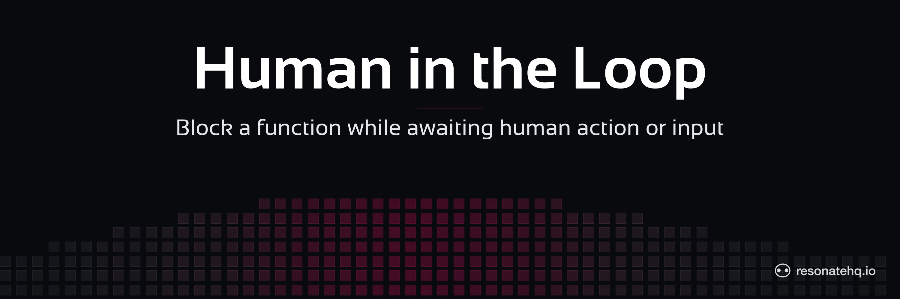

<p align="center">
  <picture>
    <source media="(prefers-color-scheme: dark)" srcset="./assets/banner-dark.png">
    <source media="(prefers-color-scheme: light)" srcset="./assets/banner-light.png">
    
  </picture>
</p>

<p align="center">
  <a href="https://resonatehq.github.io/examples-ci/">
    
  </a>
</p>

# Human-In-The-Loop

**Resonate Python SDK**

This example showcases Resonate's ability to block a function execution's progress while waiting for an action or input from a human.

Instructions on [How to run this example](#how-to-run-the-example) are below.

## Indefinite function suspension

The Human-In-The-Loop example showcases how Resonate enables a function to suspend execution for an indefinite amount of time. When the workflow calls `ctx.promise()` and then `await`s the resulting future, execution pauses and resumes only when an external caller resolves the promise.

```python
async def foo(ctx: Context, workflow_id: str) -> dict[str, str]:
    blocking_promise = ctx.promise()
    promise_id = await blocking_promise.id()

    # Notify the reviewer with the promise id they must resolve
    await ctx.run(send_email, promise_id)

    # Suspend until the external party resolves the promise
    await blocking_promise

    return {"message": f"workflow {workflow_id} completed"}
```

This enables a wide range of use cases where a function may depend on a human interaction or human input for it to continue.

Use cases like this have traditionally been quite complex to solve, requiring the steps to be broken up and triggered by schedules or a queuing architecture.

Resonate pushes that complexity into the platform, enabling a much simpler developer experience for these use cases.

## Deduplication

With Resonate, each function invocation pairs with a promise.
Each promise has a unique ID in the system.

The Resonate system deduplicates based on the promise ID and will either reconnect to a PENDING execution, or return the result of the RESOLVED promise.

This example showcases how this works in the gateway:

```python
@app.post("/start-workflow")
async def start_workflow(request: Request) -> dict[str, Any]:
    data = await request.json()
    workflow_id = data["workflow_id"]
    # Fire and forget — Resonate deduplicates on workflow_id
    _resonate.run(workflow_id, foo, workflow_id)
    return {"message": f"workflow {workflow_id} started"}
```

## Load balancing and recovery

This example is capable of showcasing Resonate's automatic load balancing and recovery.

Run multiple workers and start multiple workflows.
You will eventually see each worker start executing a workflow.

Try killing one of the workers while the workflow is blocked and watch it recover on the other worker.

## How to run the example

This example application uses [uv](https://docs.astral.sh/uv/) as the Python environment and package manager.

After cloning this repo, change directory into the root of the project and run the following command to install dependencies:

```shell
uv sync
```

This example application requires that a Resonate Server is running locally.

```shell
brew install resonatehq/tap/resonate
resonate dev
```

You will need 3 terminals to run this example, one for the HTTP Gateway, one for the Worker, and one to send a cURL request. This does not include the terminal where you might have started the Resonate Server.

In _Terminal 1_, start the HTTP Gateway:

```shell
uv run gateway
```

In _Terminal 2_, start the Worker:

```shell
uv run worker
```

In _Terminal 3_, send the cURL request to start the workflow:

```shell
curl -X POST http://localhost:5001/start-workflow -H "Content-Type: application/json" -d '{"workflow_id": "hitl-001"}'
```

The worker will print a link that you can navigate to in your browser, which sends another request to the gateway, resolving the blocking promise and allowing the workflow to complete.

## Learn More

- [Resonate Documentation](https://docs.resonatehq.io)
- [Human-in-the-Loop Pattern](https://docs.resonatehq.io/get-started/examples/human-in-the-loop)
- [Python SDK Guide](https://docs.resonatehq.io/develop/python)
